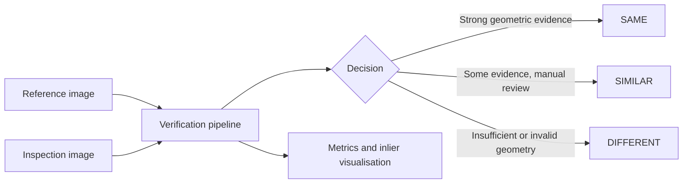
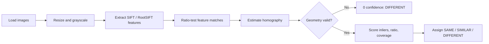

# Stone Slab Verification System

An offline computer-vision application that checks whether two photographs show the same physical stone slab. It is designed to reject visually similar slabs cut from the same quarry block by verifying the geometry of local vein features, rather than relying on colour or texture alone.

## What it does

- Compares two images and returns `SAME`, `SIMILAR`, or `DIFFERENT`.
- Searches one query image against the five bundled reference slabs.
- Provides a command-line interface, FastAPI service, and browser dashboard.
- Evaluates the bundled 100-pair benchmark and writes a CSV report.
- Produces an inlier-only visualisation for pairwise matches.

## At a glance



The system checks whether distinctive local surface features line up under one consistent planar transformation. It does not use the filenames, labels, or stone type to make a decision.

## Quick start

Requires Python 3.10+.

```bash
python -m venv .venv
.venv\Scripts\activate
pip install -r requirements.txt
```

Start the dashboard:

```bash
uvicorn server:app --reload
```

Open `http://127.0.0.1:8000`. The service redirects to the UI.

## Commands

Compare two images and save an inlier visualisation:

```bash
python match.py --image-a <reference.jpg> --image-b <query.jpg> --out output
```

Run the bundled benchmark:

```bash
python evaluate.py --data Intern_Assignment_Dataset --pairs Intern_Assignment_Dataset/pairs.csv --out results.csv
```

Run the test suite:

```bash
python -m pytest -q
```

## How matching works

1. Images are loaded safely, resized to a maximum edge of 1024 pixels, and converted to grayscale.
2. SIFT keypoints are extracted (up to 6,000 per image) and transformed to RootSIFT descriptors.
3. A brute-force L2 matcher applies Lowe's 0.75 ratio test.
4. `cv2.findHomography` estimates a planar transform using USAC_MAGSAC where available, otherwise RANSAC.
5. The system checks inlier count, ratio, and spatial coverage before scoring the pair.

`SAME` requires confidence of at least 60, 35 inliers, and an inlier ratio of at least 0.30. Geometry with fewer than eight inliers or coverage below 2% is invalid and receives zero confidence.



## Included benchmark

`Intern_Assignment_Dataset` contains five reference slabs, 20 query images, and 100 reference/query comparisons. A fresh local run during documentation review produced:

| Measure | Result |
|---|---:|
| Genuine pairs classified `SAME` | 10 / 10 |
| Non-matching pairs not classified `SAME` | 90 / 90 |
| Lookalikes classified `SAME` | 0 / 10 |
| Weakest genuine match | 284 inliers |
| Strongest lookalike | 6 inliers |
| Mean per-pair time | 246 ms |

These are results for the bundled dataset and current local environment; they are not a general production guarantee.

## Project layout

```text
src/                         Core preprocessing, features, matching, scoring, and visualisation
frontend/                    Static browser dashboard
tests/                       Pytest unit and API tests
Intern_Assignment_Dataset/   Reference images, query images, and benchmark pairs
match.py                     Pairwise CLI
evaluate.py                  Batch benchmark CLI
tune.py                      SIFT vs. RootSIFT comparison script
server.py                    FastAPI application
docs/                        Business, product, architecture, and delivery documents
REPORT.md                    Evaluation notes and limitations
```

## API summary

| Endpoint | Purpose |
|---|---|
| `GET /api/health` | Health check |
| `GET /api/presets` | Bundled reference and query metadata |
| `POST /api/match` | Compare two uploads/presets, or one image against the reference inventory |
| `POST /api/gallery-search` | Rank all bundled references for one query |
| `GET /api/benchmark-results` | Read `results.csv`; generates it if absent |

The upload endpoints accept multipart form data. Files are temporarily stored only for the request and then removed.

## Notes and limitations

- The shipped reference inventory contains five images and is a demo dataset, not a production catalog.
- Confidence is a calibrated heuristic, not a probability.
- The API permits all CORS origins and has no authentication; add access control before public deployment.
- Matching may be less reliable for heavily blurred, extremely oblique, cropped, or non-planar images.

See [BRD](docs/BRD.md), [PRD](docs/PRD.md), [architecture](docs/ARCHITECTURE.md), [roadmap](docs/AGILE_ROADMAP.md), and [report](REPORT.md) for details.
