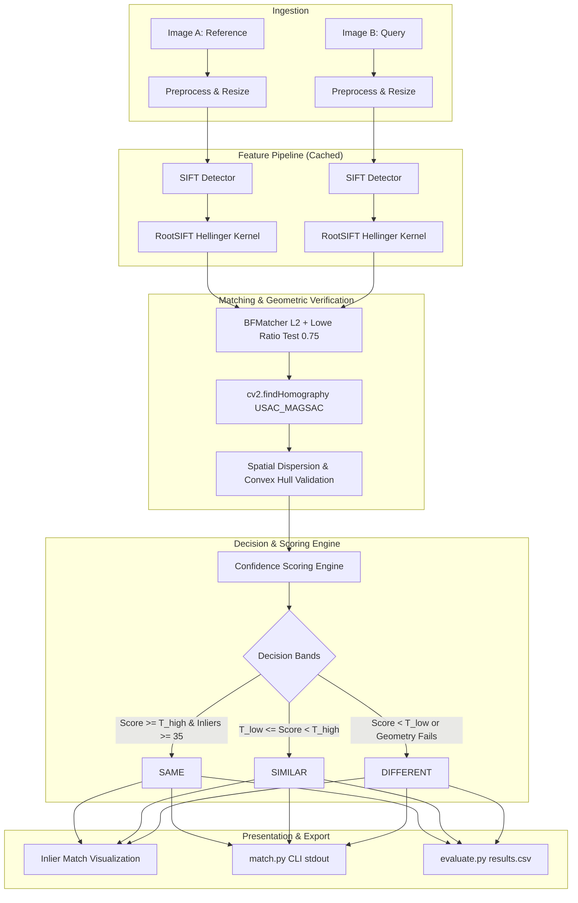

# System Architecture & Technical Design Document
## NMG Labs — Image Matching Pipeline (`nmg-image-matching`)

---

### 1. Architectural Overview & Design Philosophy

The architecture is engineered around the core thesis: **same physical slab verification requires strict geometric planar consensus of localized natural feature points.**



---

### 2. Mathematical & Algorithmic Formulation

#### 2.1 Feature Representation: SIFT to RootSIFT
Standard SIFT computes 128-dimensional gradient orientation histograms. Matching with Euclidean distance ($L_2$) implicitly models descriptor space with a Gaussian distribution, which underweights low-frequency histogram bins and overemphasizes outlier bins.

The **Hellinger distance** for histograms $x, y \ge 0$ is defined as:
$$d_H(x, y) = \sqrt{1 - \sum_{i=1}^d \sqrt{x_i y_i}}$$

Applying the RootSIFT transformation maps the Hellinger distance directly into standard Euclidean distance:
1. Normalize to $L_1$ norm:
   $$\tilde{x}_i = \frac{x_i}{\sum_{k=1}^{128} |x_k| + \epsilon}$$
2. Element-wise square root:
   $$z_i = \sqrt{\tilde{x}_i}$$
3. Descendant property:
   $$\|z\|_2^2 = \sum_{i=1}^{128} (\sqrt{\tilde{x}_i})^2 = \sum_{i=1}^{128} \tilde{x}_i = 1$$
   *Because $\|z\|_2 = 1$ naturally, secondary $L_2$ normalization is mathematically redundant and omitted.*

---

#### 2.2 Lowe's Ratio Test
For each query descriptor $d_A$, find the two nearest neighbors $n_{B,1}$ and $n_{B,2}$ in image B with distances $r_1 \le r_2$:
$$\text{Good match} \iff \frac{r_1}{r_2} \le \tau_{\text{ratio}} \quad (\tau_{\text{ratio}} = 0.75)$$
This effectively suppresses repetitive textures (e.g. uniform marble granulations) that produce near-equidistant candidate matches.

---

#### 2.3 Geometric Transformation: Planar Homography
Because stone slabs are rigid planar surfaces, any two views of the same slab related by rotation, scale, tilt, or translation obey a planar homography $H \in \mathbb{R}^{3 \times 3}$:
$$\begin{bmatrix} x' \\ y' \\ 1 \end{bmatrix} \sim H \begin{bmatrix} x \\ y \\ 1 \end{bmatrix} = \begin{bmatrix} h_{11} & h_{12} & h_{13} \\ h_{21} & h_{22} & h_{23} \\ h_{31} & h_{32} & h_{33} \end{bmatrix} \begin{bmatrix} x \\ y \\ 1 \end{bmatrix}$$

We estimate $H$ using `cv2.findHomography` with `cv2.USAC_MAGSAC` (or `cv2.RANSAC` fallback) and maximum reprojection error $\tau_{\text{reproj}} = 4.0\text{ px}$.

##### Non-Rigid Spatial & Degeneracy Verification:
Rather than relying on a rigid bounds check on $\det(H)$ (which is scale-ambiguous and mathematically flawed for projectively warped views), we perform physically grounded checks:
1. **Minimum Inliers:** Require $N_{\text{inliers}} \ge 8$ for valid homography consideration.
2. **Convex Hull Coverage:**
   $$\text{AreaRatio}_A = \frac{\text{ConvexHullArea}(pts_{A,\text{inliers}})}{W_A \cdot H_A}$$
   $$\text{AreaRatio}_B = \frac{\text{ConvexHullArea}(pts_{B,\text{inliers}})}{W_B \cdot H_B}$$
   $$\text{Coverage} = \min(\text{AreaRatio}_A, \text{AreaRatio}_B)$$
3. **Collinearity / Aspect Degeneracy:**
   Reject matches if inliers collapse into a 1D line or extreme aspect ratio ($> 20:1$).

---

#### 2.4 Confidence Scoring Formula

The confidence score $S \in [0.0, 100.0]$ must be strictly 0 if geometric consensus fails, and scale smoothly based on inlier count and inlier ratio:

```python
if not valid_geometry or num_inliers < 4:
    confidence = 0.0
else:
    # Blend inlier count saturation and inlier ratio
    count_score = min(1.0, num_inliers / 60.0)
    ratio_score = inlier_ratio  # inliers / good_matches
    
    # Combined base score
    raw_score = 0.60 * count_score + 0.40 * ratio_score
    
    # Coverage dampener (penalizes tight point clustering < 2% area)
    coverage_penalty = 1.0 if coverage >= 0.05 else max(0.2, coverage / 0.05)
    
    confidence = round(raw_score * coverage_penalty * 100.0, 1)
```

##### Three-Band Decision Thresholds:
- **`SAME`:** $\text{Confidence} \ge 60.0\%$ AND $N_{\text{inliers}} \ge 35$ AND $R_{\text{inlier}} \ge 0.30$.
- **`SIMILAR`:** $25.0\% \le \text{Confidence} < 60.0\%$ OR ($10 \le N_{\text{inliers}} < 35$).
- **`DIFFERENT`:** $\text{Confidence} < 25.0\%$ OR $N_{\text{inliers}} < 10$.

---

### 3. Modular File & Directory Structure

```
nmg/
├── docs/
│   ├── BRD.md                   # Business Requirements Document
│   ├── PRD.md                   # Product Requirements Document
│   ├── ARCHITECTURE.md          # Technical Design & System Architecture
│   └── AGILE_ROADMAP.md         # Agile Epics, Sprints & User Stories
├── src/
│   ├── __init__.py
│   ├── config.py                # Hyperparameters, paths & default thresholds
│   ├── preprocessor.py          # Image loading, resizing, CLAHE & color conversion
│   ├── extractor.py             # SIFT / RootSIFT feature extraction & caching
│   ├── matcher.py               # L2 matcher, Lowe ratio test & RANSAC homography
│   ├── scoring.py               # Spatial checks, scoring formula & band decider
│   ├── visualizer.py            # Inlier-only match drawing & export
│   └── image_matcher.py         # Unified match_pair(img_a, img_b) -> MatchResult
├── match.py                     # Official CLI: python match.py --image-a ... --image-b ...
├── evaluate.py                  # Official Batch CLI: python evaluate.py --data ... --pairs ...
├── tune.py                      # Parameter grid search & threshold calibration script
├── Intern_Assignment_Dataset/   # Benchmark dataset (5 references x 20 queries)
├── requirements.txt             # Pinned dependencies
├── README.md                    # Setup and run instructions
└── REPORT.md                    # Empirical findings, benchmark numbers & failure analysis
```

---

### 4. Data Structures & Core Interface Contracts

#### 4.1 MatchResult Contract
```python
from dataclasses import dataclass
from typing import Optional, List, Tuple
import numpy as np

@dataclass
class MatchResult:
    image_a_path: str
    image_b_path: str
    keypoints_a: int
    keypoints_b: int
    total_matches: int
    good_matches: int
    inliers: int
    inlier_ratio: float
    confidence: float
    band: str                    # "SAME" | "SIMILAR" | "DIFFERENT"
    time_ms: float
    homography: Optional[np.ndarray] = None
    inlier_matches: Optional[List] = None
    status: str = "SUCCESS"      # "SUCCESS" | "FILE_NOT_FOUND" | "CORRUPT_IMAGE"
    error_message: Optional[str] = None
```

#### 4.2 In-Memory Caching Design
In batch evaluation across $M \times N$ pairs, extracting features on the same reference image $N$ times causes unnecessary computational overhead.
- An LRU/Dictionary feature cache (`FeatureCache`) stores `(keypoints, descriptors, shape)` keyed by absolute image file path and file modification timestamp (`st_mtime`).
- The cache strictly acts as an execution accelerator; cache hits and cache misses produce bit-for-bit identical results.
