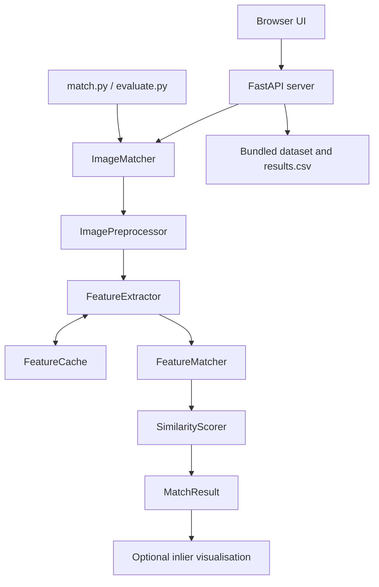
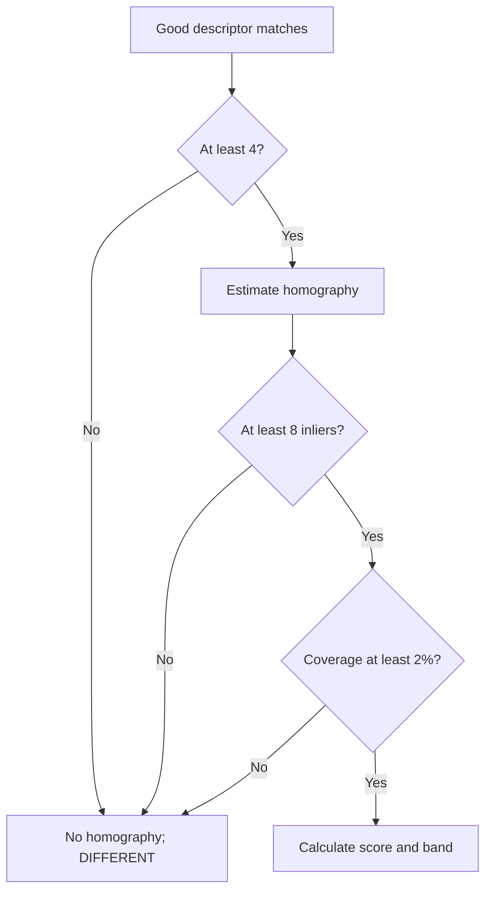

# Architecture

## Overview



## Components

| Component | Responsibility |
|---|---|
| `src/config.py` | Immutable dataclass configuration and thresholds. |
| `src/preprocessor.py` | Safe image read, resize, grayscale conversion, optional CLAHE. |
| `src/extractor.py` | SIFT/RootSIFT extraction and path/mtime-keyed feature cache. |
| `src/matcher.py` | BF L2 KNN matching, ratio filtering, homography, and coverage check. |
| `src/scoring.py` | Confidence calculation and decision band selection. |
| `src/image_matcher.py` | Orchestrates the pipeline and exposes `MatchResult`. |
| `src/visualizer.py` | Renders and encodes inlier-only evidence images. |
| `server.py` | FastAPI endpoints and static file mounts. |
| `frontend/` | Dependency-free HTML/CSS/JavaScript dashboard. |

## Processing pipeline

1. Load BGR images using `numpy.fromfile` and `cv2.imdecode` for Windows-friendly path handling.
2. Resize only if the longest edge exceeds 1024 pixels; convert to grayscale.
3. Detect SIFT features with a 6,000-keypoint cap and contrast threshold 0.01.
4. Use RootSIFT by default: L1-normalise each descriptor, then take its element-wise square root.
5. Run BFMatcher L2 `knnMatch(k=2)` and keep matches that pass the 0.75 Lowe ratio test.
6. Estimate a homography with USAC_MAGSAC when OpenCV exposes it; otherwise use RANSAC.
7. Check the inlier count and convex-hull spatial coverage on both images.
8. Score valid geometry and classify the result.

When the standard pass is `DIFFERENT`, the matcher optionally performs a second pass with CLAHE local-contrast normalisation. It selects that pass only if the resulting band or evidence is stronger. Both passes use identical matching, homography, and coverage rules.

### Evidence gate



## Score

For valid geometry:

```text
count_factor = min(1, inliers / 50)
raw_score = (0.65 * count_factor + 0.35 * inlier_ratio) * 100
```

When coverage is below 5%, the score is multiplied by `max(0.3, coverage / 0.05)`. Invalid geometry gets 0 confidence.

## Interfaces

| Interface | Use |
|---|---|
| `match_pair(path_a, path_b)` | Simple Python function for one comparison. |
| `ImageMatcher.match(path_a, path_b)` | Reusable class interface with optional caching. |
| `match.py` | Direct CLI comparison and visualisation export. |
| `evaluate.py` | CSV batch evaluation. |
| FastAPI endpoints | Browser or external client integration. |

## Data and lifecycle

The API mounts `frontend/` at `/ui` and the bundled dataset at `/dataset`. Uploaded files are copied to a temporary directory, processed, and removed in a `finally` block. The feature cache is process-local and invalidates entries when the file modification time changes.

For auto-match and catalog search, the server compares a query against each bundled reference, ranks candidates by confidence, and returns a top match only when the leading result has the `SAME` band.

## Deployment considerations

This is a local/demo architecture. Before exposing it beyond a trusted environment, restrict CORS, validate preset paths, enforce file upload limits, add authentication, and move reference inventory/results storage to an appropriate managed system.
