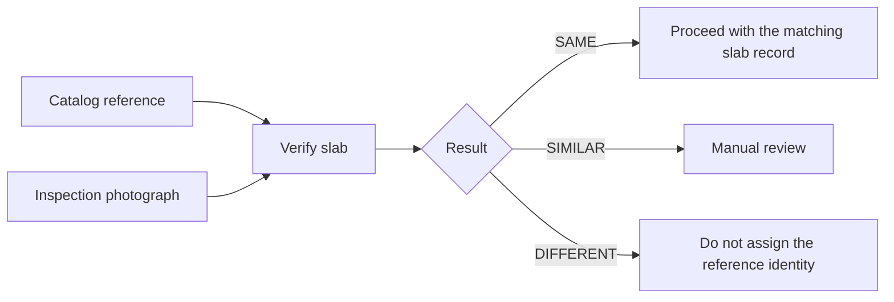

# Business Requirements Document

## Purpose

Provide a practical way to verify whether an inspection photograph depicts the exact same physical stone slab as a catalog reference. The main business risk is accepting a nearby slab from the same quarry block because it has similar colour and texture.

## Users

| User | Need |
|---|---|
| Warehouse or quality operator | Verify an incoming or outgoing slab against its catalog image. |
| Inventory reviewer | Search a small reference catalog using a single inspection image. |
| Technical evaluator | Reproduce benchmark results and inspect match evidence. |

## Business outcomes

- Reduce mistaken assignment of sibling slabs.
- Give operators a clear three-band decision with supporting metrics.
- Keep the workflow local and reproducible with no external image service.
- Make evaluation results auditable through a CSV and inlier visualisation.

## Business flow

`SAME` is intended for strong automated confirmation. `SIMILAR` deliberately preserves uncertainty instead of turning weak evidence into an approval.

## Scope

### In scope

- Pairwise image verification.
- Search against the bundled reference catalog.
- Local CLI, REST API, and browser dashboard.
- Batch evaluation of supplied image-pair CSV files.
- Rejection of invalid, missing, or unreadable images without an unhandled exception.

### Out of scope

- Automatic catalog enrollment or database management.
- User accounts, authorization, audit retention, or multi-tenant operation.
- Guarantees for unseen cameras, stone types, or production-scale inventories.
- Determining a slab identity from metadata or filenames.

## Success measures

The shipped benchmark is the acceptance dataset. The current implementation is considered successful when it processes every pair, classifies genuine pairs as `SAME`, and does not classify sibling lookalikes as `SAME`.

Current validated run: 10/10 genuine pairs classified `SAME`, 90/90 non-matches not classified `SAME`, and 0/10 lookalikes accepted. These results are dataset-specific.

## Operating assumptions

- The surface being compared is approximately planar.
- A reference or query image retains enough visible vein and texture detail.
- Users treat `SIMILAR` as a manual-review outcome, not approval.
- The operator is responsible for choosing an appropriate reference catalog in a real deployment.

## Risks and controls

| Risk | Control in current system |
|---|---|
| Lookalike acceptance | Homography, spatial coverage, and strict `SAME` thresholds. |
| Poor or missing image | Safe image loading and `ERROR` response. |
| Weak evidence | `SIMILAR` and `DIFFERENT` outcomes; no automatic approval. |
| Public service exposure | Not addressed; API has permissive CORS and no authentication. |
