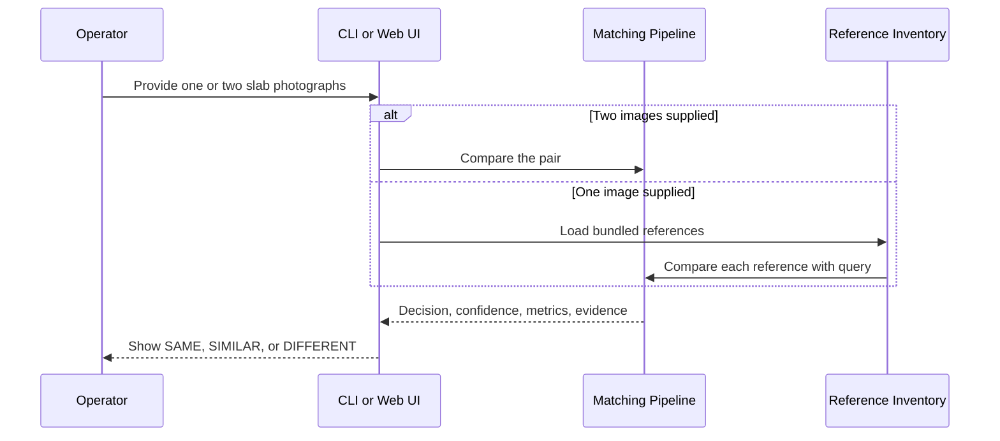

# Product Requirements Document

## Product summary

The Stone Slab Verification System is a local web and command-line product for comparing slab photos. It uses local feature correspondence and planar geometry to return a decision, confidence score, metrics, and optional visual evidence.

## Primary user journey

## Functional requirements

| ID | Requirement | Current implementation |
|---|---|---|
| FR-1 | Compare two image files. | `match.py`, `POST /api/match`, and `ImageMatcher.match`. |
| FR-2 | Search one image against the bundled references. | One-image `/api/match` mode and `POST /api/gallery-search`. |
| FR-3 | Return decision, confidence, match metrics, timing, and errors. | `MatchResult` and API responses. |
| FR-4 | Show evidence for pairwise matches. | JPEG with inlier matches only. |
| FR-5 | Evaluate a CSV of pairs. | `evaluate.py` writes a 13-column result CSV. |
| FR-6 | Handle missing/corrupt images gracefully. | Returns status `ERROR`, confidence 0, band `DIFFERENT`. |
| FR-7 | Provide a browser workflow. | Static UI at `/ui/` with verify, catalog, and benchmark tabs. |

## Decision rules

| Band | Rule |
|---|---|
| `SAME` | Confidence >= 60, at least 35 inliers, and inlier ratio >= 0.30. |
| `SIMILAR` | Confidence >= 25 or at least 10 inliers, but not `SAME`. |
| `DIFFERENT` | All other outcomes, including invalid geometry. |

Geometry is valid only when there are at least eight inliers and the smaller normalised convex-hull coverage of the two images is at least 2%.

The decision is deliberately gated: a high raw match count cannot produce `SAME` unless the matches also form valid, sufficiently spread geometric evidence.

## Inputs and outputs

### Pairwise input

- Two image paths in the CLI, or multipart uploads/preset paths in the API.
- For auto-match, one image is compared with every bundled reference image.

### Pairwise output

`MatchResult` includes input paths, keypoint counts, total and good matches, inliers, inlier ratio, confidence, band, elapsed time, homography, visualisation data, and status/error information.

### Batch input

`pairs.csv` must provide `image_a`, `image_b`, `label`, and `pair_type`. Labels may be `unknown`.

### Batch output

The result CSV contains image names, labels, pair type, keypoint counts, match metrics, confidence, band, and elapsed time.

## Non-functional requirements

- Runs offline after dependency installation.
- Supports paths containing spaces and non-ASCII characters when loading images.
- Reuses extracted features within a batch through an in-memory cache.
- Uses deterministic configuration defaults; vision-library operations can still vary slightly by platform/version.

## Constraints

- The current UI and API operate on the bundled five-reference inventory.
- Uploaded files are written to a request-specific temporary directory and deleted after processing.
- No authentication, file-size limit, or rate limit is implemented.
- The product should not be used as the only decision-maker for unseen production conditions without validation.
